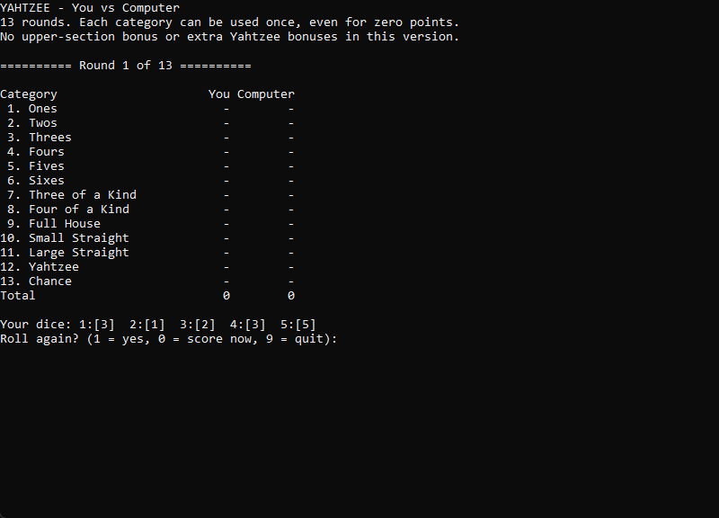
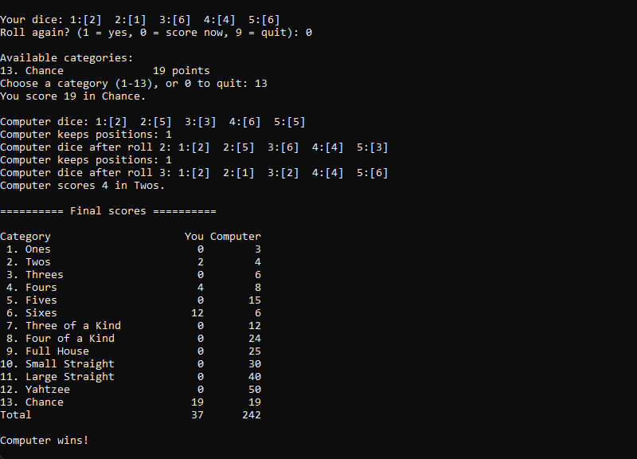

# Yahtzee in C

A simple console Yahtzee game written in C. You play against the computer for 13 rounds, rolling dice and choosing scoring categories.

## Gameplay

Starting a game:



Final scores after all 13 rounds:



## Compile and run

With GCC installed, open a terminal in this folder:

```sh
gcc yahtzee.c -o yahtzee
```

On Windows PowerShell:

```powershell
.\yahtzee.exe
```

On Linux or macOS:

```sh
./yahtzee
```

If GNU Make is installed, you can also use:

```sh
make
make run
make clean
```

These commands compile the game, compile and run it, and remove the executable, respectively.

## Playing

- Roll five dice, then choose whether to roll again. Each turn allows up to three rolls.
- When rolling again, enter `1` to keep a die or `0` to reroll it.
- Choose an unused scoring category. The game shows how many points each choice would give.
- Both players use each of the 13 categories once. A zero score still uses a category.
- The player with the highest total after round 13 wins.
- Enter `9` at the roll-again prompt or `0` at category selection to quit.

## Scoring

| Category | Points |
| --- | --- |
| Ones to Sixes | Sum of dice matching that number |
| Three / Four of a Kind | Sum of all dice if enough dice match |
| Full House | 25 for exactly three of one number and two of another |
| Small Straight | 30 for four consecutive numbers |
| Large Straight | 40 for five consecutive numbers |
| Yahtzee | 50 for five matching dice |
| Chance | Sum of all dice |

This version has no upper-section bonus, extra Yahtzee bonuses or joker rules.

## Computer strategy

The computer checks which categories are still available. It keeps a completed high-scoring combination, otherwise tries to keep matching dice, work towards a straight, or save high dice for Chance. After rolling, it chooses the unused category giving the most points.

The reroll strategy uses simple rules. It does not calculate every possible outcome or guarantee an optimal move. Choosing categories also considers only the current turn, rather than future rounds.

## Code

Everything is in `yahtzee.c`, using arrays, loops and functions for input, dice rolls, scoring, the computer turn and the scoreboard. An unused score is stored as `-1` so it can be distinguished from a used category worth zero points.
